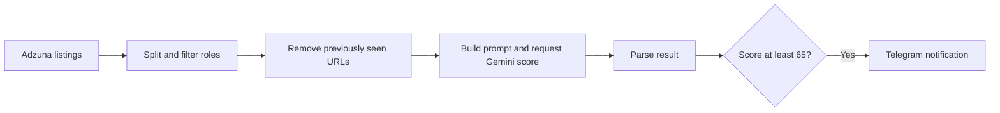

# AI Job Intelligence & Alerts

**An AI-assisted job discovery system that finds relevant opportunities, filters repeat listings, evaluates fit, and sends actionable Telegram alerts.**

**Professional title:** AI Engineer — Growth & Automation Systems
**Teaching context:** Laoni AI Academy
**Focus:** multi-source data ingestion · n8n orchestration · Gemini structured analysis · deterministic filtering · Telegram delivery
**Portfolio:** https://olawaleolaonipekun.vercel.app

## The problem

Good opportunities are scattered across job boards, duplicated between sources, and easy to miss. Checking each site manually is time-consuming; sending every listing to an AI model wastes requests and returns noise. This system automates discovery and prioritization while leaving applications and final decisions with the human.

## Versions and honest release status

| Version | Scope | Evidence |
|---|---|---|
| **Current private running workflow** | Owner reports a seven-source job monitoring system with Telegram notifications | Operational status confirmed by owner; the current seven-source n8n export and recent sanitized execution logs are **not yet committed here** |
| **Public teaching snapshot (this repository)** | One Adzuna source → filter → deduplication by redirect URL across runs → Gemini scoring → Telegram | `ai-job-alerts.n8n.json`, ten nodes. The export has `active: false`, which is normal for a portable template and does not describe the private deployment |

The seven job sources discussed in the build history are **RemoteOK, Remotive, Jobicy, Arbeitnow, Himalayas, Adzuna and We Work Remotely**. Some can be consumed through feeds; *seven sources* does not necessarily mean seven separate REST APIs. Do not treat this repository as proof all seven connections are configured or operational until a safely sanitized export and real execution evidence are added.

## Historical classroom variant

A separate Laoni AI Academy exercise used seven nodes and one We Work Remotely RSS feed. Its redacted graph records the path through filtering, duplicate removal, Gemini and Telegram. It contains no execution history.

## Inside the public Adzuna export

The duplicate-removal node uses the listing’s redirect URL and retains up to 10,000 prior values. A listing seen under a different URL can bypass that check. Malformed model text falls back to a score of zero. Applicants decide whether to apply.

## Try the teaching workflow

Import the [public JSON](ai-job-alerts.n8n.json) into a separate n8n workspace with scheduling disabled. Configure your own test credentials and chat destination. Use synthetic listings to check a repeated URL, an invalid model response and scores immediately below and at 65 before testing delivery to your own chat.

The private version’s schedule, per-source results and delivery reliability still require current execution evidence.
